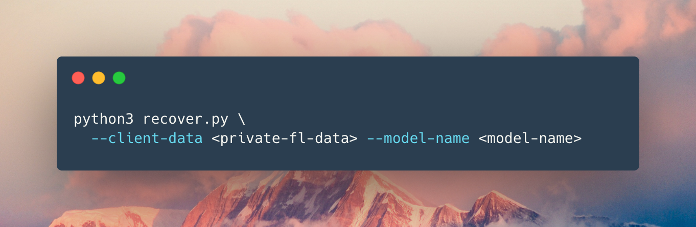

# Stealing Exact Training Data from Clients during Federated Learning

This repo is an official implementation for the paper *Stealing Exact Training Data from Clients during Federated Learning*.

Malicious adversaries can employ gradient inversion attacks to reverse-engineer private data using the model updates of a round in Federated Learning (FL). While there have been developments in gradient inversion for text, exact text recovery by a malicious client has so far remained infeasible, as FedAvg entangles the gradient contributions of many clients and obscures the signal of any individual sentence. We introduce a novel attack pipeline that unwinds this entanglement progressively through an iterative loop, in which the gradient contributions of sentences recovered exactly in one round are subtracted from the aggregate, exposing the remaining sentences for recovery in the next iteration. We show, for the first time, exact sentence recovery, with 100\% precision, and on aggregates containing up to $4\times$ more tokens than the model's hidden dimension, we recover up to 80.2\% of client sentences exactly, a regime where existing attacks recover none exactly.

---

## What this does

Given one gradient $\bar g = \sum_c w_c\, g_c$ aggregated over clients (standard
FedAvg with a single local step), the attack captures the aggregate, recovers the token set from the first-block gradient, searches for candidate sentences, verifies and peels the correct candidates from the residual gradient.

## 1. Installation

```bash
python3 -m venv .venv && source .venv/bin/activate
pip install -r requirements.txt
```

Requires Python 3.10+, a CUDA GPU for non-trivial batches, and a locally cached Hugging Face checkpoint for a model.

## 2. Usage

### A. simulate a federated round and recover it
Provide a client JSON (client 0 is the known acting client whose contribution is
subtracted; clients 1+ hold the private sentences to recover):

```bash
python3 recover.py \
  --client-data examples/client_data_example.json \
  --model-name <model-name-on-huggingface> \
  --run-dir runs/demo
```

The run prints the recovered sentences and writes a summary JSON. Because ground truth
is known in this mode, it also reports exact-recovery metrics.

### B. Client JSON format

```json
{
  "clients": [
    {"weight": 1.0, "texts": ["A short acting-client sentence."]},
    {"weight": 1.0, "texts": ["First private sentence.", "Second private sentence."]},
    {"weight": 1.0, "texts": ["A sentence held by another client."]}
  ]
}
```

Run `python3 recover.py --help` for the full list of detailed, stage-by-stage
description of every knob and help information. 

## 3. License

Our source code is under the CC BY-NC-SA 4.0.

## 4. Authors

- Omkar Shrikanth
- Soham Dambalkar
- Parag Pal
- Advik Raj Basani
- Arnab K. Paul

First-author order settled via a Clash Royale tournament.

## 5. Ethical Statement
Our attack exposes a privacy risk in FL, a participating client may reconstruct other clients' training text from aggregate updates. This capability poses a dual-use risk, as it could enable unauthorized access to sensitive information. Our evaluation uses existing research datasets rather than data collected from deployed federated systems. Our aim is to inform privacy assessments and the development of stronger defenses, not to facilitate unauthorized data recovery.
